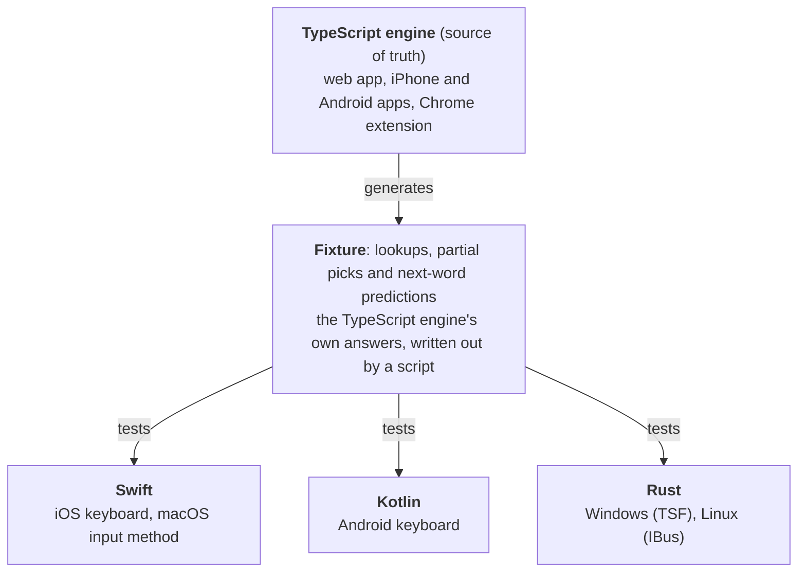

# How Nôm Na Việt is built

Nôm Na Việt ([nomnaviet.com](https://nomnaviet.com)) is a dictionary, a Vietnamese ↔ Chữ Nôm converter, OCR for woodblock pages, handwriting recognition, a reader for classical texts, flashcards, and an input method for typing Nôm from Telex. It runs on the web, iPhone, Android, Chrome, macOS, Windows and Linux, and one developer builds it.

| | |
|---|---|
| **46,800+** | Hán Nôm characters |
| **36** | classical texts in the reader |
| **7** | platforms, one typing engine |
| **72,000+** | compounds |

## One typing engine, seven front ends

Typing Nôm from Telex is a search problem: `vieejtnam` has to split into *việt nam*, find 越南, rank it, and still let you pick only 越 and keep composing. The rules are modelled on Apple's Pinyin keyboard: syllables typed together, typing without tones, compounds by their initials, partial picks, and suggestions for the character that usually comes next.

Getting that right once is hard. Getting it identical on seven platforms is the architecture.

Every port runs the fixture in its own test suite, and all of them read the same SQLite dictionary built from the platform's data. The desktop key handling (what Space, digits, arrows and Escape do) is a second shared layer: written once for macOS, ported to Rust, and used by both the Windows and the Linux front ends. When a rule changes, the fixture changes, and every port's tests fail until it matches.

The desktop builds ship as [Soạn Nôm](https://github.com/nomnaviet/soan-nom): a notarized disk image for macOS, a Windows installer that works in both 64-bit and 32-bit apps, and `.deb` and `.rpm` packages for Linux. They also install the NomNaTong fonts, so other apps can draw what you type.

## Reading old pages: the OCR pipeline

Woodblock prints are vertical columns of dense characters on stained paper. The pipeline splits the problem the way a reader would:

1. **Find the columns**, with a detector trained on scanned pages.
2. **Read each character**, with a classifier on tight crops.
3. **Give it a reading**: the converter picks the quốc ngữ in context.
4. **Let people correct it**: boxes, readings and fixes on the photo.

The models are trained with page data from Columbia University's Digitizing Vietnam project, mixed with Nôm data so that learning a new style doesn't erase the old one. Augmentation makes synthetic samples look like real paper and ink, which is what brought rare Nôm characters to 93.9% (96.6% top-1 on real-world crops overall). OCR never runs in the web server: requests go to a queue, and a separate worker process takes them one at a time, so a burst of uploads can't take the site down.

## Data and operations

- **Data:** scrapers write raw entries to Postgres as JSON, then a transform normalizes them into characters, readings, meanings and compounds. Compounds carry embeddings for meaning search, and a fine-tuned ranker reorders converter candidates by context.
- **Serving:** a single containerized deployment, with OCR and embeddings in their own services.
- **Shipping:** every change goes through a pull request with two automated reviewers, one before the push and one on GitHub. Deploys are run by hand, and the database is backed up regularly to off-site storage.

## Decisions I didn't take

A one-person product lives or dies by what it doesn't build. Some of the calls:

| Option | Decision |
|---|---|
| **Kubernetes** | **Rejected.** The services share files on disk that a multi-node cluster could only share through storage the hosting provider doesn't offer, and two services each fill a small node by themselves. Splitting one server into three would have meant three ways to fail instead of one. |
| **One shared binary for every platform** | **Native ports instead.** Each platform gets its own port in its native language, and the shared fixture keeps them identical. |
| **A macOS `.pkg` installer** | **A self-installing disk image.** A signed `.pkg` needs a separate certificate, and a drag onto a link to the system's input-method folder is silently refused. Double-clicking Nôm in the disk image installs it for the user, with no password. |
| **The Mac App Store** | **Not yet.** Input methods have a weak track record in review, and the store requires a sandbox. A notarized download works today. |
| **Code signing on Windows** | **Skipped for now.** A monthly fee for one warning dialog. The download page explains the warning instead. |
| **Publishing the OCR model** | **Not released.** The model weights stay private. |

Try it at [nomnaviet.com](https://nomnaviet.com) · desktop downloads at [github.com/nomnaviet/soan-nom](https://github.com/nomnaviet/soan-nom) · demo video at [youtu.be/PZE0QOQPH-I](https://youtu.be/PZE0QOQPH-I)
